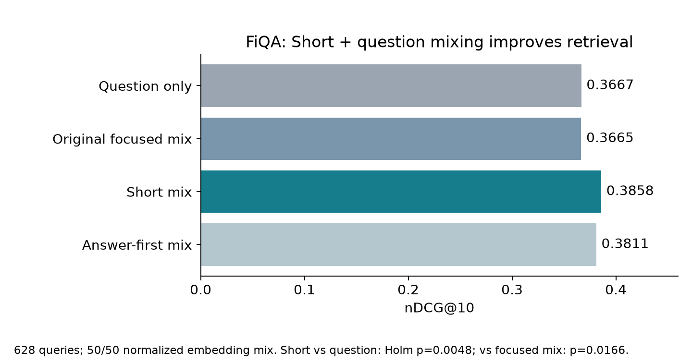
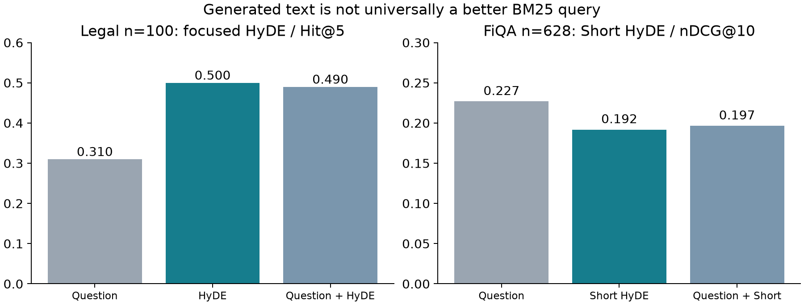
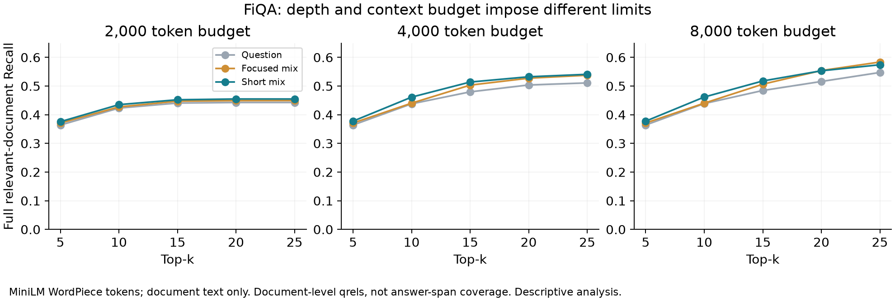

# HyDE: prompt style, sparse retrieval, and context budgets

Weekly update · 9 November 2026 · Cheryl

**Main finding:** On FiQA, mixing the question embedding with Short-prompt HyDE improves nDCG@10 over both question-only retrieval and the original-prompt mixture. The benefit depends on the retrieval route and dataset.

## 1. Short-prompt HyDE improves mixed dense retrieval

FiQA: **628 validation queries**, excluding the 20 queries used to explore prompts; full **57,638-document corpus**. Historical benchmark baselines had already been inspected, so this is not a completely unseen benchmark.

| Query representation | nDCG@10 | Holm p vs question-only | Holm p vs original focused mix |
|---|---:|---:|---:|
| Question only | 0.3667 | — | — |
| Original focused: 50/50 question + HyDE | 0.3665 | — | — |
| **Short: 50/50 question + HyDE** | **0.3858** | **0.0048** | **0.0166** |
| Answer-first: 50/50 question + HyDE | 0.3811 | 0.2054 | 0.1627 |

Short mixture improves by **0.0192 nDCG**, or **5.23% relative**, over question-only retrieval. “50/50” is normalized embedding mixing, not text concatenation or a BM25 fusion weight.



**Statistics:** 12 fixed primary comparisons; two-sided paired sign-flip permutation tests, 100,000 draws, Holm correction across all 12. Query-level inference. [All comparisons](fiqa_primary_tests.csv) · [Paired query scores](fiqa_ndcg10_paired.csv).

Short pure HyDE improves over original pure HyDE (0.3555 vs 0.3133), but does not beat question-only dense retrieval. Answer-first pure HyDE declines to 0.2782. Neither new mixed hybrid significantly beats the original focused mixed hybrid after correction.

## 2. Better dense queries do not guarantee better BM25 queries

Q = original question; H = generated hypothetical passage. Each within-dataset comparison holds the corpus and BM25 settings fixed.

| Dataset / metric | BM25(Q) | BM25(H) | BM25(Q+H) |
|---|---:|---:|---:|
| Legal, original focused H · Hit@5 · n=100 | 31% | **50%** | **49%** |
| FiQA, Short H · nDCG@10 · n=628 | **0.2268** | 0.1918 | 0.1965 |

Legal H and Q+H improve over Q: Holm p=0.0119 and 0.0053 across 10 post-hoc Hit@5 comparisons. **These 100 Legal queries had already been inspected; this is exploratory evidence.** Legal hybrid gains do not survive this correction (e.g., 41% → 57%, p=0.0569).

FiQA Short H improves over the old focused H (0.1488; Holm p=0.0002), but still falls below Q (p=0.0498, near the threshold). None of the new sparse-query configurations significantly beats Q under the same dense route and fusion weight. FiQA sparse nDCG@10 uses a separate family of 20 comparisons.



[FiQA sparse tests](fiqa_sparse_tests.csv) · [Legal sparse tests](legal_sparse_tests.csv).

## 3. Retrieval depth and context budget impose different limits

FiQA, same 628 queries. Documents are delivered in rank order; the final document is truncated when the budget runs out. No skipping long documents.

**Short mixture: fraction of labeled relevant documents delivered in full**

| Top-k | 2,000 tokens | 4,000 tokens | 8,000 tokens |
|---|---:|---:|---:|
| 5 | 37.57% | 37.76% | 37.76% |
| 10 | 43.52% | 46.14% | 46.17% |
| 15 | 45.22% | 51.40% | 51.78% |
| 20 | 45.49% | 53.24% | 55.32% |
| 25 | 45.49% | 54.09% | 57.42% |

- **Depth limit:** At Top-10, 4,000 → 8,000 tokens adds only 0.03 percentage points. At 4,000 tokens, 98.57% of queries already fit all ten documents.
- **Budget limit:** At 2,000 tokens, Top-20 → Top-25 adds no full-document Recall. The mean delivered length is already about 1,995 tokens.
- At Top-20 / 4,000 tokens, full-document Recall is 50.38% for question-only, 52.74% for focused mix, and 53.24% for Short mix. These are descriptive differences; Short is not best in every setting.



**Measurement boundary:** Tokens are pinned MiniLM WordPiece tokens, not GPT reader tokens. Budgets cover document text only, excluding prompt overhead. FiQA has document-level relevance labels, not supporting spans: full/partial document delivery is not verified answer-evidence coverage. No reader accuracy was tested. [Budget metrics](context_budget_metrics.csv).

## Interpretation and next step

A diagnostic review suggests that Short can reduce adjacent-topic expansion while retaining question terms; it can also remove useful mechanisms, such as dividend reinvestment. Across 628 queries, Short mix improves over focused mix on 166, worsens on 123, and ties on 339. Fifteen cases were reviewed by the assistant, not independently annotated by humans.

**Next experiment:** separate requested length from constraint wording with a 2×2 design. Existing Short vs focused changes both, so the improvement cannot yet be attributed to brevity alone. This experiment has not been run.

## Settings, scope, and reproduction

- Generator: `gpt-5.4-2026-03-05`, temperature 0, reasoning none, no tools, output cap 160 tokens. Short requests 30–50 words; focused / Answer-first request 70–100.
- Encoder: `all-MiniLM-L6-v2`, revision `1110a243fdf4706b3f48f1d95db1a4f5529b4d41`, masked mean pooling, L2 normalization, max 256 tokens, CPU float32. Full document text is used for context-budget accounting.
- BM25: k1=1.2, b=0.75, binary query-term counts. RRF: top 100 per route, constant 60, dense weight 0.25 or 0.50.
- Expanded depth analysis: 180 secondary comparisons, separately Holm-adjusted. Short mix nDCG@10 vs question has the same raw p≈0.00053 but p=0.0758 in that expanded family, versus p=0.0048 in the fixed 12-test primary family. Both scopes are reported; do not select the smaller adjusted p.
- Existing full experiments were reused. The two-prompt 628-query generation cost about $1.964; later analyses used no API calls. No LongBench rerun.

Run from this directory to reproduce the main statistics and charts from the included tables (no API, corpus, or model download):

```bash
python -m pip install numpy pandas scipy matplotlib
OPENBLAS_NUM_THREADS=1 python reproduce.py
```

[Protocols and original validation records](protocols_and_validation.json) · [628-query metric summary](fiqa_628_metrics.csv) · [All secondary depth tests](fiqa_secondary_depth_tests.csv).

This folder publishes the concise findings and aggregate/paired scores. Original generation checkpoints, corpora, embeddings, and complete per-query delivery records remain in the local handoff archive; they are not part of this findings-only update.
