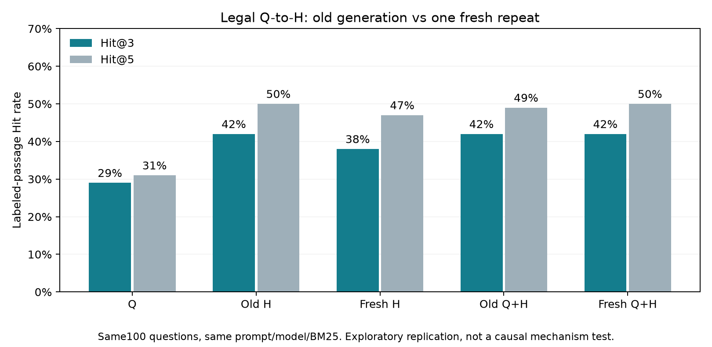

# Legal Q/H retrieval and HyDE

Published 18 November 2026 · Fresh generation run 17 November 2026

**Q is the original question. H is a hypothetical legal passage generated from Q.** The same 100 questions and 4,876 real passages are used throughout this page. Hit@k measures retrieval of the labeled passage, not answer accuracy.

## Mechanism and comparison with HyDE

| Method | Search representation | How real passages are ranked | What is combined? |
|---|---|---|---|
| BM25(Q) | Original question text | BM25 term matching | Nothing; baseline |
| BM25(H) | Generated passage text | Same BM25 index and parameters | Query text is replaced by H |
| BM25(Q+H) | Question text followed by H | Same BM25 index and parameters | **Text concatenation**, not vectors |
| Pure HyDE, dense | Embedding of H | Similarity to real-passage embeddings | H supplies the dense query vector |
| Question–HyDE mix, project extension | `normalize(0.5E(Q) + 0.5E(H))` | Similarity to real-passage embeddings | **Vectors**, not text |
| HyDE hybrid, project extension | Dense HyDE-based ranking and BM25(Q) ranking | Reciprocal-rank fusion | **Ranked lists**, not text or vectors |

`E` is the encoder; vectors are normalized before mixing. An embedding-mixing weight and an RRF weight control different steps. H+Q refers to the concatenated BM25 query here, written Q+H in the code.

The [original HyDE paper](https://aclanthology.org/2023.acl-long.99/) describes dense retrieval through generated-document embeddings. BM25(H) shares its generation idea but uses lexical retrieval. Our dense implementation uses pinned MiniLM, rather than reproducing the paper's original encoder.

H may add legal terminology absent from a scenario-based question. For example, saved question 13 gains the term **Black direction**, matching the relevant passage title. This is a plausible explanation, not a proven causal mechanism. [Examples and limits](MECHANISM.md)

## Original versus regenerated H

We regenerated H once per question with the same `gpt-5.4-2026-03-05` snapshot, exact focused160 prompt, temperature 0, reasoning none and 160-token cap. Q and BM25 remain fixed. All 100 new calls completed; none of the new texts was identical to its original text. These are two generations of the same method, not two different prompts.

### Top 5 — Q baseline: 31%

| Query | Hit@5 | Adjusted p | Correction family | Significantly better than Q? |
|---|---:|---:|---|---|
| Original H | 50% | 0.0119 | Holm10 | Yes |
| Original Q+H | 49% | 0.0053 | Holm10 | Yes |
| Regenerated H | 47% | 0.0633 | Holm8 | No |
| Regenerated Q+H | 50% | 0.0025 | Holm8 | Yes |

### Top 3 — Q baseline: 29%

| Query | Hit@3 | Adjusted p | Correction family | Significantly better than Q? |
|---|---:|---:|---|---|
| Original H | 42% | 0.0702 | Holm3 | No |
| Original Q+H | 42% | 0.0319 | Holm3 | Yes |
| Regenerated H | 38% | 0.6802 | Holm8 | No |
| Regenerated Q+H | 42% | 0.0878 | Holm8 | No |

These are exact paired McNemar tests. **Each row retains its original correction family:** 10 historical Top-5 contrasts, 3 original Top-3 contrasts, or 8 fresh-generation contrasts across Top 3 and Top 5. The eight displayed rows were **not** corrected together. Equal Hit rates can have different p-values because paired wins/losses and correction families differ. [All comparison data](data/comparisons_vs_q.csv)



## Findings and scope

- Q+H beats Q at Top 5 in both generation rounds under their respective corrections.
- Pure H falls from 50% to 47% at Top 5; the fresh comparison does not pass Holm8. This does not prove that H has no benefit or that the two rounds differ.
- Neither fresh Top-3 comparison passes Holm8.
- All 300 original Q/H/Q+H Top-100 rankings replay exactly. The fresh run's 200 new rankings, 100 calls and costs were independently checked.

This is one repeat on previously inspected questions. It does not establish cross-run equivalence, independent generalization or which generated terms caused the gain. Fresh generation cost about **$0.1995**; publishing and offline checks add no API calls.

## Reproduce from published tables

```bash
cd presentation/legal_qh_replication_20261118
python -m pip install numpy pandas scipy
OPENBLAS_NUM_THREADS=1 python reproduce.py
```

[Original replication README](REPLICATION_DETAILS.md) · [Original Top-3 README](TOP3_DETAILS.md) · [Full-run code and exact prompt](../../person3_legal_regeneration/README.md) · [Independent validation](data/replication_validation.json) · [Earlier weekly findings](../hyde_weekly_20261109/README.md)
