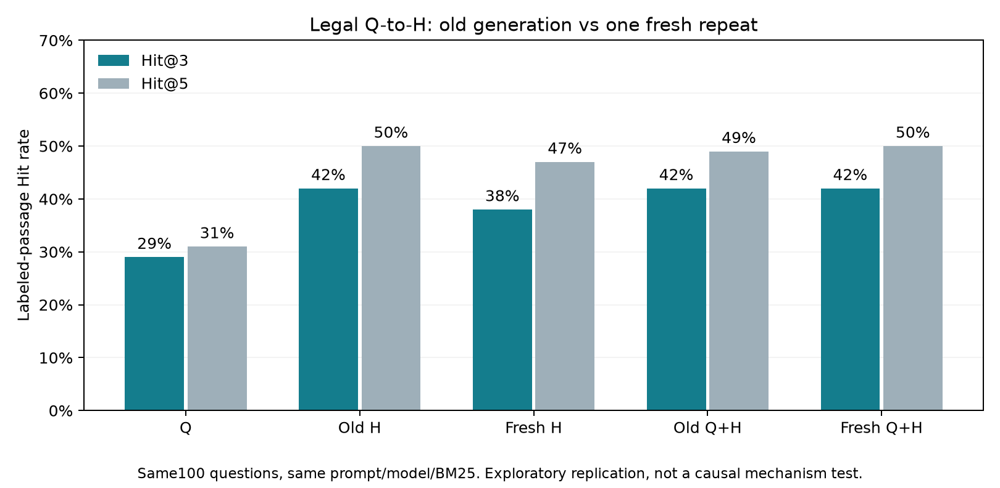

# Legal Q-to-H fresh-generation replication

One fresh H per question, with the original prompt and model.

| Query | Hit@3 | Hit@5 |
|---|---:|---:|
| Q | 29% | 31% |
| Old H | 42% | 50% |
| Fresh H | 38% | 47% |
| Old Q+H | 42% | 49% |
| Fresh Q+H | 42% | 50% |

All 300 original Q/H/Q+H Top100 lists replay exactly. All 100 new response IDs differ from the original run; **0/100 generated texts are identical**. New response status counts: `{'completed': 100}`.

| k | Paired comparison | Wins | Losses | Raw p | Holm8 p |
|---:|---|---:|---:|---:|---:|
| 3 | Fresh H vs Q | 19 | 10 | 0.13605 | 0.68023 |
| 3 | Fresh Q+H vs Q | 19 | 6 | 0.01463 | 0.08780 |
| 3 | Fresh H vs Old H | 10 | 14 | 0.54126 | 1.00000 |
| 3 | Fresh Q+H vs Old Q+H | 5 | 5 | 1.00000 | 1.00000 |
| 5 | Fresh H vs Q | 25 | 9 | 0.00904 | 0.06329 |
| 5 | Fresh Q+H vs Q | 23 | 4 | 0.00031 | 0.00249 |
| 5 | Fresh H vs Old H | 10 | 13 | 0.67764 | 1.00000 |
| 5 | Fresh Q+H vs Old Q+H | 8 | 7 | 1.00000 | 1.00000 |



Settings: gpt-5.4-2026-03-05, Responses API, temperature 0, reasoning none, output cap 160, original focused160 prompt requesting 70–100 words. Full 4,876-passage corpus, binary-query BM25 k1=1.2/b=.75, stable corpus-index ties. No prompt, model, ranking or question selection changes.

Holm8 covers these eight prelisted post-hoc comparisons only. The same 100 questions were inspected before; this is a computational repeat, not independent dataset confirmation. Similar fresh/old scores or nonsignificant differences do not establish equivalence. Regeneration does not prove which terms caused the gain, or that generated/final answers are correct.

New cost estimate: **$0.199505**; cumulative **$5.017645 / $7**. Saved usage at $2.50/$15 per million input/output tokens, ignoring cached-input discounts; not a billing statement. [Official model pricing](https://developers.openai.com/api/docs/models/gpt-5.4).

[All metrics](data/replication_summary.csv) · [All tests](data/regenerated_tests_holm8.csv) · [Text/ranking stability](data/generation_stability.csv) · [Independent validation](data/replication_validation.json)

Recheck retained results without new API calls, from the repository root:

```bash
OPENBLAS_NUM_THREADS=1 ../work/meeting10_venv/bin/python person3_legal_regeneration/run.py evaluate
OPENBLAS_NUM_THREADS=1 ../work/meeting10_venv/bin/python person3_legal_regeneration/verify_and_report.py
```
