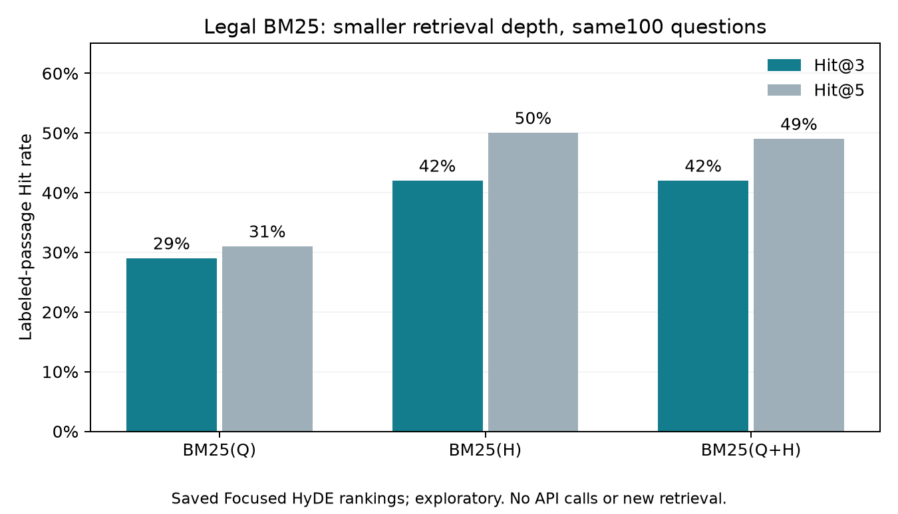

# Legal BM25 at Top 3

Same 100 questions and saved focused160 rankings; no API calls.

| Query | Hit@3 | Hit@5, historical reference |
|---|---:|---:|
| BM25(Q) | 29% | 31% |
| BM25(H) | 42% | 50% |
| BM25(Q+H) | 42% | 49% |

| Top 3 paired comparison | Wins | Losses | Raw p | Holm3 p |
|---|---:|---:|---:|---:|
| BM25(H) vs BM25(Q) | 23 | 10 | 0.03508 | 0.07016 |
| BM25(Q+H) vs BM25(Q) | 18 | 5 | 0.01062 | 0.03187 |
| BM25(H) vs BM25(Q+H) | 6 | 6 | 1.00000 | 1.00000 |



Holm3 covers these three post-hoc Top 3 comparisons only; it does not adjust earlier Top 5 tests or historical benchmark inspection. Hit measures retrieval of a labeled passage, not answer accuracy.

Reproduce from retained rankings, from the repository root:

```bash
.venv/bin/python person3_legal_small_k/run.py prepare
OPENBLAS_NUM_THREADS=1 .venv/bin/python person3_legal_small_k/run.py evaluate
```
