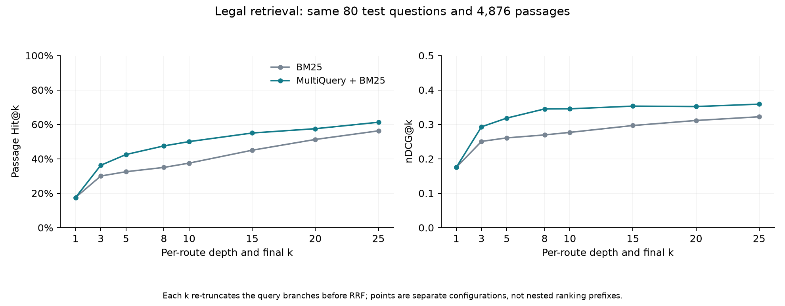
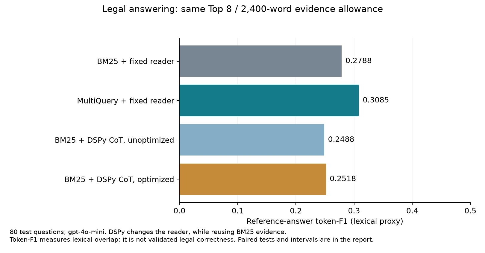

# Legal MultiQueryRetriever and DSPy

Meeting 10 · 17 November 2026 · Cheryl

**Primary retrieval result:** MultiQuery Hit@5 is 42.5%, versus 32.5% for BM25 (+10.0 percentage points; exact paired McNemar p=0.02148). It is higher in this exploratory primary comparison.

This study separates changing retrieval queries from changing the answer program. All 100 questions were previously inspected; the test split isolates only this optimization round.

## Dataset and fixed comparison

- Legal RAG Bench: 100 questions, 4,876 original title+text passages. Exactly one labeled relevant passage per question; 95 distinct labeled passages.
- Fixed seed 42 split by labeled passage: 10 optimizer-training questions, 10 optimizer-validation questions, 80 test questions. No labeled passage group crosses these splits.
- Model: `gpt-4o-mini`; returned snapshots: `gpt-4o-mini-2024-07-18`. Reader temperature 0, output cap 512 tokens.
- Framework versions: LangChain Classic `1.0.8`, DSPy `3.5.0`, LangChain OpenAI `1.8.1`.
- Same full corpus and BM25 algebra as the prior work: k1=1.2,b=.75,binary query counts,stable original-corpus-index ties. All 100 saved baseline Top100 rankings replay exactly.

## Methods

**MultiQueryRetriever:** The native LangChain default prompt requests three alternative questions; `include_original=True` retains the original question. No prompt tuning or custom rewrite cleanup is added. Each branch retrieves 25 original passages. The native unique union is retained, then an explicit equal-weight RRF adaptation (constant 60) ranks a common evidence allowance.

For each reported k, every branch is first truncated to k and RRF returns k passages. Thus the Top 5/Top 8/Top 25 runs are separate depth configurations, not prefixes of one master ranking; their Hit values need not be monotonic.

**DSPy:** A native ChainOfThought answer program reads the same original-question BM25 Top 8 passages. MIPROv2 `auto="light"` optimizes instructions on the 10+10 development questions. It may internally bootstrap development traces to propose instructions, but the final test program contains zero labeled or bootstrapped demonstrations. The unoptimized CoT control separates instruction optimization from merely changing to a CoT reader. DSPy does not change retrieval in this experiment.

Every reader receives at most 8 original passages and 2,400 document words in ranking order; the final passage is prefix-truncated and delivery then stops. The allowance excludes question/instruction/label overhead. Unlike the teammate LongBench experiment, the Legal passages are not rechunked into 300-word chunks.

## Retrieval on all 80 test questions

| k | BM25 Hit@k | MultiQuery Hit@k | BM25 nDCG@k | MultiQuery nDCG@k |
|---:|---:|---:|---:|---:|
| 1 | 17.5% | 17.5% | 0.1750 | 0.1750 |
| 3 | 30.0% | 36.2% | 0.2506 | 0.2930 |
| 5 | 32.5% | 42.5% | 0.2608 | 0.3183 |
| 8 | 35.0% | 47.5% | 0.2694 | 0.3449 |
| 10 | 37.5% | 50.0% | 0.2768 | 0.3453 |
| 15 | 45.0% | 55.0% | 0.2967 | 0.3530 |
| 20 | 51.2% | 57.5% | 0.3114 | 0.3519 |
| 25 | 56.2% | 61.3% | 0.3221 | 0.3588 |



Primary paired Hit@5 difference: **+0.1000**, unadjusted marginal 95% paired question-bootstrap interval **[+0.0250, +0.1750]** (not simultaneous); wins/losses/ties=9/1/70. Exact McNemar p=0.02148. Other depths are descriptive. Each question has one labeled passage, so labeled Recall@k equals Hit@k.

| Reader method | Retrieval route | Hit@5 | Hit@8 |
|---|---|---:|---:|
| BM25 + fixed reader | Same BM25 ranks | 32.5% | 35.0% |
| MultiQuery + fixed reader | MultiQuery+BM25 | 42.5% | 47.5% |
| BM25 + DSPy CoT, unoptimized | Same BM25 ranks | 32.5% | 35.0% |
| BM25 + DSPy CoT, optimized | Same BM25 ranks | 32.5% | 35.0% |

## Answering on the same 80 test questions

| Method | Token-F1 | Normalized exact match | n |
|---|---:|---:|---:|
| BM25 + fixed reader | 0.2788 | 0.0% | 80 |
| MultiQuery + fixed reader | 0.3085 | 0.0% | 80 |
| BM25 + DSPy CoT, unoptimized | 0.2488 | 0.0% | 80 |
| BM25 + DSPy CoT, optimized | 0.2518 | 0.0% | 80 |



| Paired token-F1 comparison | Mean difference | Unadjusted marginal 95% paired interval | Raw p | Holm3 p |
|---|---:|---|---:|---:|
| MultiQuery + fixed reader minus BM25 + fixed reader | +0.0297 | [+0.0039, +0.0574] | 0.03157 | 0.09471 |
| BM25 + DSPy CoT, optimized minus BM25 + fixed reader | -0.0271 | [-0.0618, +0.0065] | 0.12521 | 0.25042 |
| BM25 + DSPy CoT, optimized minus BM25 + DSPy CoT, unoptimized | +0.0029 | [-0.0077, +0.0140] | 0.60423 | 0.60423 |

**None of the three reader comparisons passes Holm3 correction.** MultiQuery has higher mean token-F1, but this study does not establish a corrected reader improvement. Its marginal interval excludes zero while Holm3 p is above .05 because the displayed intervals are unadjusted individual intervals, not simultaneous intervals for the three comparisons. The interval does not override the multiplicity-adjusted test.

For optimized DSPy versus BM25, neither an improvement nor inferiority is established. Optimization also does not establish an improvement over the unoptimized CoT control. These statements concern lexical token-F1, not legal answer accuracy.

Tests use 100,000 two-sided paired sign flips and Holm correction across the three listed reader contrasts. Intervals use 20,000 paired question-bootstrap draws; every displayed bootstrap interval is unadjusted/marginal, not simultaneous. They do not account for shared-source dependence or all historical project comparisons.

**Token-F1 and exact match are lexical reference-answer proxies, not validated legal correctness or multiple-choice accuracy.** A correct paraphrase may score poorly and overlapping language may score well. No LLM judge score is presented as ground truth.

## Evidence actually delivered

| Method | Mean full passages | Mean partial passages | Mean words | Gold passage full | Gold passage touched |
|---|---:|---:|---:|---:|---:|
| BM25 + fixed reader | 7.42 | 0.41 | 2191.4 | 35.0% | 35.0% |
| MultiQuery + fixed reader | 7.62 | 0.33 | 2202.9 | 47.5% | 47.5% |
| BM25 + DSPy CoT, unoptimized | 7.42 | 0.41 | 2191.4 | 35.0% | 35.0% |
| BM25 + DSPy CoT, optimized | 7.42 | 0.41 | 2191.4 | 35.0% | 35.0% |

“Touched” means at least a prefix of the labeled passage was delivered; this does not establish that its answer-bearing evidence was included.

Reader outputs ending with a length limit: **0**; these remain in the scores and are identified in the independent validation record.

## API cost and latency

| Method | Test reader USD | Test query-generation USD | Modeled fresh USD/1,000 test queries | New reader-call USD |
|---|---:|---:|---:|---:|
| BM25 + fixed reader | 0.039873 | 0.000000 | 0.4984 | 0.039873 |
| MultiQuery + fixed reader | 0.040799 | 0.006513 | 0.5914 | 0.040799 |
| BM25 + DSPy CoT, unoptimized | 0.046636 | 0.000000 | 0.5830 | 0.046636 |
| BM25 + DSPy CoT, optimized | 0.047270 | 0.000000 | 0.5909 | 0.047270 |

MultiQuery generation across all 100 questions costs **$0.0082404**: test 80 **$0.0065125**, development 20 **$0.0017278**. These are matched by exact native query prompt, not prorated. The per 1,000 method cost includes test query generation plus reader calls; development generation is excluded.

DSPy one-time optimization new-call estimate: **$0.06466785** from **77** unique calls. This is excluded from per-query test inference. Total new-call estimate for this study: **$0.2474853**, from **497** unique saved upstream calls; finish reasons: `{'stop': 497}`, with no unresolved reservations. Estimates use saved token usage and fixed prices, ignoring cached-input discounts; they are not billing statements.

Modeled fresh costs count every successful logical reader HTTP request at its retained upstream cost, including requests served from the local exact-payload cache. The separate new-call column records what this execution newly requested. DSPy parser recovery, if any, is included.

| API stage | Successful requests | Retained upstream p50 seconds | Current request p50 seconds |
|---|---:|---:|---:|
| BM25 + fixed reader | 80 | 1.1090 | 1.1177 |
| MultiQuery + fixed reader | 80 | 1.1655 | 1.1739 |
| BM25 + DSPy CoT, unoptimized | 80 | 2.1721 | 2.1781 |
| BM25 + DSPy CoT, optimized | 80 | 2.1745 | 2.1864 |
| MultiQuery generation, test80 | 80 | 1.5927 | — |

Retained latency is the source API-call duration reused by exact cache hits. Current request time includes proxy/cache handling. Neither column is end-to-end RAG latency; generation and reader medians must not be summed into a claimed measured method latency.

## Reproduce and merge

Run from the repository root with the isolated environment. The first three lines rebuild and verify saved results without paid calls:

```bash
OPENBLAS_NUM_THREADS=1 ../work/meeting10_venv/bin/python person3_meeting10_legal/run.py evaluate
OPENBLAS_NUM_THREADS=1 ../work/meeting10_venv/bin/python person3_meeting10_legal/verify.py
OPENBLAS_NUM_THREADS=1 ../work/meeting10_venv/bin/python person3_meeting10_legal/report.py
```

The full experiment stages are `prepare`, `multiquery`, `optimize`, `readers`, then `evaluate`. Paid stages use the durable local budget proxy and reuse exact successful requests. Full replay requires the pinned original dataset and retained local checkpoints; the public package contains metrics/protocols rather than prompts, raw reader answers or optimizer development datasets.

[Source code](../../person3_meeting10_legal/) · [Frozen protocol](protocol.json) · [Exact split](selection.json) · [Independent validation](independent_validation.json) · [Dependency lock](requirements.lock.txt) · [API summary](api_summary.json) · [Cost matching](cost_breakdown.json)

[Cross-dataset long-form rows](team_results_long.csv) retain dataset, stage changed, n, metric, score, matched baseline, delta, paired interval, cost and setup. Only Legal results are filled. Legal lexical F1 must remain distinct from the teammate LongBench multiple-choice accuracy; no teammate numbers are inferred or pooled.

Limitations: historical benchmark exposure; 80 evaluation questions; source dependence unadjusted; one labeled passage per question may miss other useful passages; fixed lexical answer metrics; page/answer correctness not manually validated.
