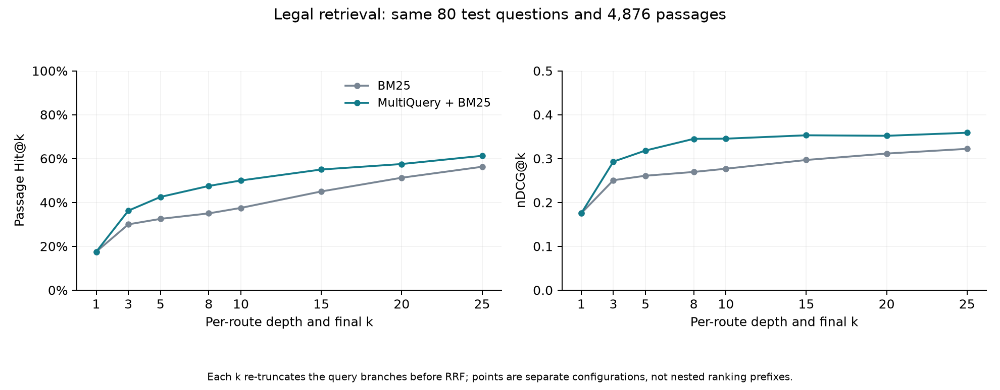
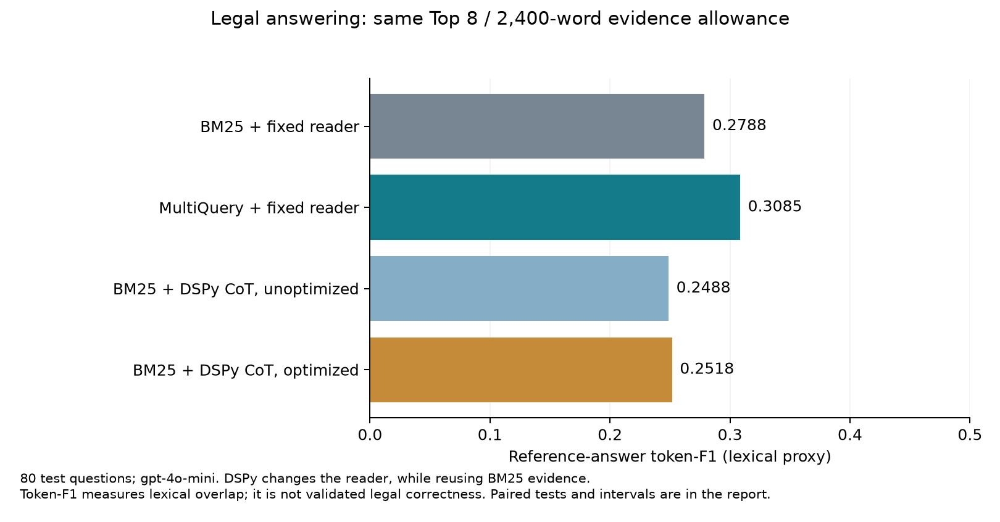

# Legal: MultiQueryRetriever and DSPy

Meeting 10 · 17 November 2026 · Cheryl

**MultiQuery improves retrieval. Neither method establishes an improvement in answer quality after correction.**

Same 4,876 passages; 20 development and 80 evaluation questions, grouped by labeled passage. Model: `gpt-4o-mini-2024-07-18`. Every reader uses Top 8 and a 2,400-word evidence budget.

| Method | Hit@5 | Hit@10 | Hit@20 | Answer token-F1 | USD / 1,000 queries |
|---|---:|---:|---:|---:|---:|
| BM25 + fixed reader | 32.5% | 37.5% | 51.25% | 0.2788 | 0.4984 |
| **MultiQuery + BM25 + fixed reader** | **42.5%** | **50.0%** | **57.5%** | **0.3085** | 0.5914 |
| BM25 + DSPy CoT, before optimization | 32.5% | 37.5% | 51.25% | 0.2488 | 0.5830 |
| BM25 + DSPy CoT, after optimization | 32.5% | 37.5% | 51.25% | 0.2518 | 0.5909 |

- **Retrieval:** MultiQuery adds 10 percentage points at Hit@5; 9 paired wins and 1 loss, exact McNemar **p=0.02148**. Other depths are descriptive.
- **Answers:** MultiQuery vs BM25 has Holm3 **p=0.09471**; optimized DSPy vs its unoptimized control has **p=0.60423**. None of the three answer comparisons passes correction.
- **Cost:** $0.2475 total, including $0.0647 for one-time DSPy optimization. Per-query costs above include MultiQuery generation and exclude optimization.

MultiQuery uses LangChain's default three rewrites plus the original question, followed by RRF. Each k is fused separately. DSPy uses MIPROv2 light to optimize a CoT reader over **unchanged BM25 evidence**; final prompts contain no demonstrations.

Token-F1 is lexical overlap, not validated legal correctness. All 100 questions were previously inspected; this remains exploratory. Bootstrap intervals in the detailed report are unadjusted and do not account for shared-source dependence.





## Reproduce the statistics without API calls

```bash
cd presentation/meeting10_legal_20261117
python -m pip install numpy pandas scipy
OPENBLAS_NUM_THREADS=1 python reproduce.py
```

[Code and full-run setup](../../person3_meeting10_legal/README.md) · [Detailed report](DETAILS.md) · [All paired tests](reader_paired_tests.csv) · [Original independent audit](independent_validation.json) · [Legal + LongBench table](../meeting10_team_20261117/README.md)
