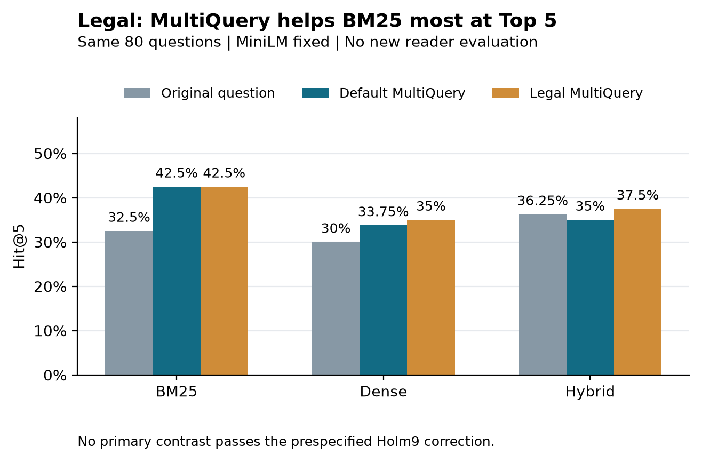
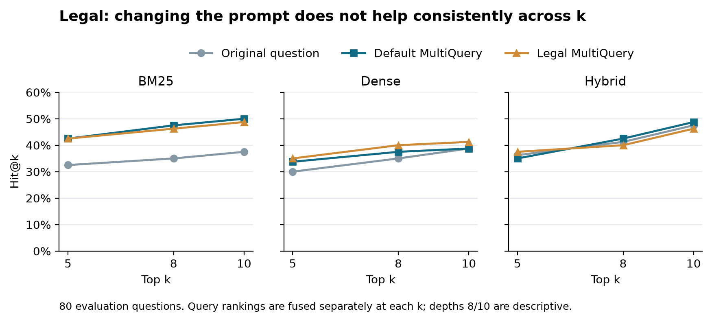

# Legal MultiQuery with dense and hybrid retrieval

23–24 November 2026 | Cheryl | Meeting 11

**Main finding:** MultiQuery helps BM25 most. The manual legal prompt gives no consistent advantage, and both automatic optimizers retain Default MultiQuery. Larger context budgets add no labeled-passage hits.

Same 80 evaluation questions, 20 development questions and 4,876 passages; unchanged passage-grouped split. Model: `gpt-4o-mini-2024-07-18`; dense encoder: pinned MiniLM-256.

## 1. Retrieval results

### Query: how is the search question prepared?

| Query | What it does |
| --- | --- |
| Original question | Searches with the user's question only. |
| Default MultiQuery | Uses a general GPT prompt to generate three alternative questions, then retains the original: four query routes. |
| Legal MultiQuery | Generates three alternatives while preserving stated legal facts, jurisdiction, procedural stage and exceptions, without inventing details; also retains the original. |

MultiQuery generates **search questions**, not HyDE hypothetical passages or final answers.

### Backend: how are passages matched?

| Backend | Matching mechanism |
| --- | --- |
| BM25 | Ranks real passages by lexical matching with the query. |
| Dense | Encodes each query with fixed MiniLM and ranks real-passage vectors by cosine similarity. |
| Hybrid | Runs BM25 and dense for the same query, then combines their rankings with reciprocal rank fusion (RRF). |

RRF combines **rank positions**, rather than directly adding lexical and cosine scores.

### How the three groups of rows work

- **BM25 rows:** Original question → one BM25 ranking → Top-k. For either MultiQuery prompt: four queries → four BM25 rankings → equal-weight RRF60 → Top-k.
- **Dense rows:** Original question → one query vector → one dense ranking → Top-k. For either MultiQuery prompt: four queries → four separate vectors and rankings → equal-weight RRF60 → Top-k. **The four query vectors are not averaged.**
- **Hybrid rows:** Each query → BM25 Top-100 + dense Top-100 → equal-weight RRF60 → one hybrid Top-100. Original-question retrieval takes its Top-k directly. Either MultiQuery prompt produces four hybrid lists, followed by another equal-weight RRF60 → final Top-k.

For MultiQuery's final fusion, each query list is first cut to k. Fusion is run separately for k=5, 8 and 10; the columns are not simple truncations of one final ranking.

| Backend | Query | Hit@5 | Hit@8 | Hit@10 |
| --- | --- | --- | --- | --- |
| BM25 | Original question | 32.50% | 35.00% | 37.50% |
| BM25 | Default MultiQuery | 42.50% | 47.50% | 50.00% |
| BM25 | Legal MultiQuery | 42.50% | 46.25% | 48.75% |
| Dense | Original question | 30.00% | 35.00% | 38.75% |
| Dense | Default MultiQuery | 33.75% | 37.50% | 38.75% |
| Dense | Legal MultiQuery | 35.00% | 40.00% | 41.25% |
| Hybrid | Original question | 36.25% | 41.25% | 47.50% |
| Hybrid | Default MultiQuery | 35.00% | 42.50% | 48.75% |
| Hybrid | Legal MultiQuery | 37.50% | 40.00% | 46.25% |

Recall equals Hit here because each question has one labeled passage. Other ranking metrics are in [the full table](retrieval_summary.csv).

## 2. Default versus legal prompt

Both prompts generate three alternatives and retain the original question. The legal version preserves stated facts, jurisdiction, procedural stage and exceptions, while prohibiting invented legal details. It was manually written and frozen before new outcomes, not DSPy-optimized. [Exact prompts](protocol.json)

The legal prompt ties default BM25 at Top 5 and modestly improves dense retrieval, but hybrid results vary with k. It does not establish a better general prompt.

### Automatic query-prompt optimization

Both optimizers targeted **query generation, not the reader**, using 10 training and 10 validation questions with BM25 nDCG@10 as the objective. Each selected instruction was frozen before evaluation on the same 80 questions and transferred unchanged to dense and hybrid. Model, three rewrites plus the original question, and retrieval settings stayed fixed.

**Both MIPROv2 and GEPA retained Default MultiQuery; neither added an improvement.** Their selected outputs reuse the historical default cache, so identical scores are expected rather than independent replications.

| Backend | Default nDCG@10 | Manual legal nDCG@10 | MIPROv2-selected | GEPA-selected |
| --- | ---: | ---: | ---: | ---: |
| BM25 | 0.3453 | 0.3416 | 0.3453 | 0.3453 |
| Dense | 0.2361 | 0.2466 | 0.2361 | 0.2361 |
| Hybrid | 0.3118 | 0.3015 | 0.3118 | 0.3118 |

Each follow-up has six paired nDCG@10 comparisons against default/manual prompts; none is significant (all Holm6 p=1.000). These are separate exploratory families, distinct from the original Hit@5 Holm9 tests below.

- **MIPROv2:** Four distinct instructions were evaluated. One requested an extra output line and failed the fixed three-line contract on all ten validation questions, scoring zero.
- **GEPA:** Reflection used training questions, generated rewrites and measured ranking/format feedback. Six versions completed full validation; the default scored 0.3387, versus 0.1676–0.3000 for the alternatives. The approximately 200-call limit ended at 210 calls because scoring finishes in batches.

The development set is small and previously inspected. Search budgets differ, and reflection uses GPT-4o-mini; this does not establish optimizer superiority or rule out benefits from a stronger or larger search.

[MIPROv2 instruction](query_optimization/selected_instruction.txt) · [MIPROv2 tests](query_optimization/primary_tests.csv) · [GEPA instruction](gepa_query/selected_instruction.txt) · [GEPA search](gepa_query/search_summary.json) · [GEPA tests](gepa_query/primary_tests.csv) · [GEPA audit](gepa_query/validation.json)

## 3. Context budget

All nine methods were tested at Top-5/8/10 × 5k/8k/10k tokens: **6,480 evaluation records**, plus 1,620 development records. Packing follows rank order and truncates only the final passage; exact evidence tokens include labels and separators.

At Top 5/8, all lists fit in 5k. At Top 10, 719/720 method-question lists fit fully; one needs 5,010 tokens. Completing it changes no hit. Increasing the budget leaves every method's delivered Hit/Recall, MRR and nDCG unchanged. A smaller minimum budget was not tested.

## 4. Statistics and interpretation

**None of nine primary Hit@5 contrasts passes Holm9.** The earlier BM25 raw p remains 0.02148; its adjusted p is 0.19336 in this nine-test family. Top-8/10 and budget comparisons are descriptive. [All paired tests](primary_tests.csv)

Query fusion preserves the earlier per-k RRF60 rule; each hybrid query first fuses BM25/dense top100 at equal weights. Alternative candidate-depth fusion changes results and remains a [secondary diagnostic](fixed100_summary.csv). The [candidate-union analysis](query_fusion_diagnostics.csv) shows evidence can be found by individual queries but lost during fusion; that larger union is not an equal-budget competitor.

Results remain exploratory on previously inspected questions, with shared-source dependence unadjusted. No new reader answers were evaluated; retrieval gains do not establish answer correctness.

[Validation](validation.json) · [Code and resume commands](CODE_README.md)
