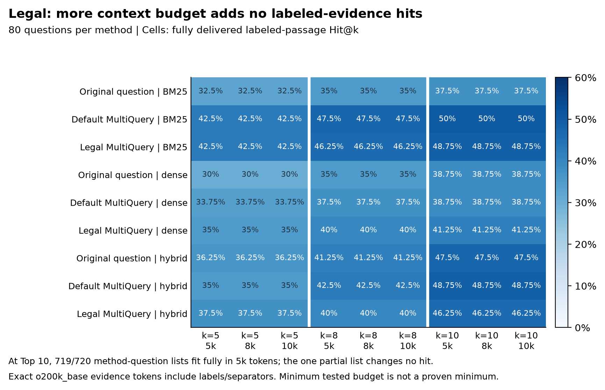

# Legal MultiQuery with dense and hybrid retrieval

23 November 2026 | Cheryl | Meeting 11

**Main finding:** MultiQuery helps BM25 most. The legal prompt gives no consistent advantage; larger context budgets add no labeled-passage hits.

Same 80 evaluation questions, 20 development questions and 4,876 passages; unchanged passage-grouped split. Model: `gpt-4o-mini-2024-07-18`; dense encoder: pinned MiniLM-256.

## 1. Retrieval results

| Backend | Query | Hit@5 | Hit@8 | Hit@10 |
| --- | --- | --- | --- | --- |
| BM25 | Original question | 32.50% | 35.00% | 37.50% |
| BM25 | Default MultiQuery | 42.50% | 47.50% | 50.00% |
| BM25 | Legal MultiQuery | 42.50% | 46.25% | 48.75% |
| Dense | Original question | 30.00% | 35.00% | 38.75% |
| Dense | Default MultiQuery | 33.75% | 37.50% | 38.75% |
| Dense | Legal MultiQuery | 35.00% | 40.00% | 41.25% |
| Hybrid | Original question | 36.25% | 41.25% | 47.50% |
| Hybrid | Default MultiQuery | 35.00% | 42.50% | 48.75% |
| Hybrid | Legal MultiQuery | 37.50% | 40.00% | 46.25% |

Recall equals Hit here because each question has one labeled passage. Other ranking metrics are in [the full table](retrieval_summary.csv).

## 2. Default versus legal prompt

Both prompts generate three alternatives and retain the original question. The legal version preserves stated facts, jurisdiction, procedural stage and exceptions, while prohibiting invented legal details. It was manually written and frozen before new outcomes, not DSPy-optimized. [Exact prompts](protocol.json)

The legal prompt ties default BM25 at Top 5 and modestly improves dense retrieval, but hybrid results vary with k. It does not establish a better general prompt.

## 3. Context budget

All nine methods were tested at Top-5/8/10 × 5k/8k/10k tokens: **6,480 evaluation records**, plus 1,620 development records. Packing follows rank order and truncates only the final passage; exact evidence tokens include labels and separators.

At Top 5/8, all lists fit in 5k. At Top 10, 719/720 method-question lists fit fully; one needs 5,010 tokens. Completing it changes no hit. Increasing the budget leaves every method's delivered Hit/Recall, MRR and nDCG unchanged. A smaller minimum budget was not tested.

## 4. Statistics and interpretation

**None of nine primary Hit@5 contrasts passes Holm9.** The earlier BM25 raw p remains 0.02148; its adjusted p is 0.19336 in this nine-test family. Top-8/10 and budget comparisons are descriptive. [All paired tests](primary_tests.csv)

Query fusion preserves the earlier per-k RRF60 rule; each hybrid query first fuses BM25/dense top100 at equal weights. Alternative candidate-depth fusion changes results and remains a [secondary diagnostic](fixed100_summary.csv). The [candidate-union analysis](query_fusion_diagnostics.csv) shows evidence can be found by individual queries but lost during fusion; that larger union is not an equal-budget competitor.

Results remain exploratory on previously inspected questions, with shared-source dependence unadjusted. No new reader answers were evaluated; retrieval gains do not establish answer correctness.

[Validation](validation.json) · [Code and resume commands](CODE_README.md)
