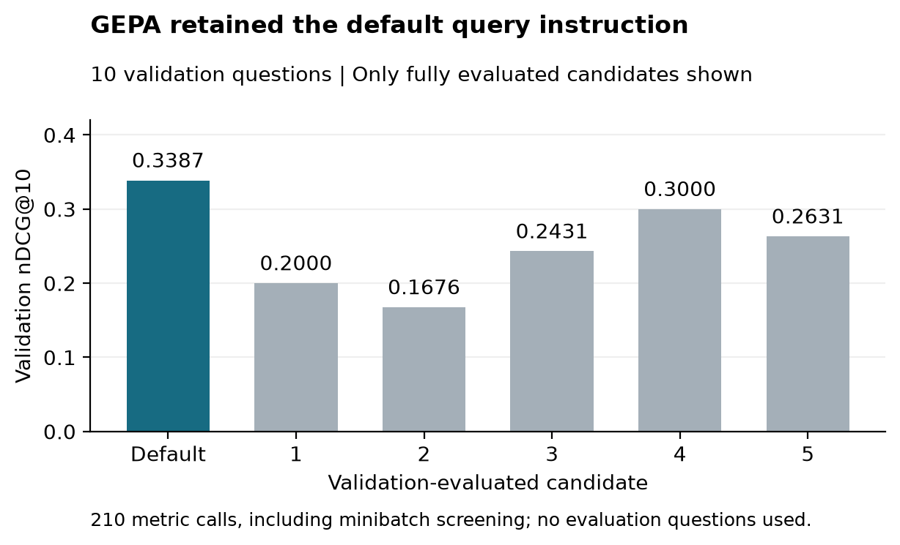

### Automatic query-prompt optimization

Both optimizers targeted **query generation, not the reader**, using 10 training and 10 validation questions with BM25 nDCG@10 as the objective. Each selected instruction was frozen before evaluation on the same 80 questions and transferred unchanged to dense and hybrid. Model, three rewrites plus the original question, and retrieval settings stayed fixed.

**Both MIPROv2 and GEPA retained Default MultiQuery; neither added an improvement.** Their selected outputs reuse the historical default cache, so identical scores are expected rather than independent replications.

| Backend | Default nDCG@10 | Manual legal nDCG@10 | MIPROv2-selected | GEPA-selected |
| --- | ---: | ---: | ---: | ---: |
| BM25 | 0.3453 | 0.3416 | 0.3453 | 0.3453 |
| Dense | 0.2361 | 0.2466 | 0.2361 | 0.2361 |
| Hybrid | 0.3118 | 0.3015 | 0.3118 | 0.3118 |

Each follow-up has six paired nDCG@10 comparisons against default/manual prompts; none is significant (all Holm6 p=1.000). These are separate exploratory families, distinct from the original Hit@5 Holm9 tests below.

- **MIPROv2:** Four distinct instructions were evaluated. One requested an extra output line and failed the fixed three-line contract on all ten validation questions, scoring zero.
- **GEPA:** Reflection used training questions, generated rewrites and measured ranking/format feedback. Six versions completed full validation; the default scored 0.3387, versus 0.1676–0.3000 for the alternatives. The approximately 200-call limit ended at 210 calls because scoring finishes in batches.

The development set is small and previously inspected. Search budgets differ, and reflection uses GPT-4o-mini; this does not establish optimizer superiority or rule out benefits from a stronger or larger search.

[MIPROv2 instruction](query_optimization/selected_instruction.txt) · [MIPROv2 tests](query_optimization/primary_tests.csv) · [GEPA instruction](gepa_query/selected_instruction.txt) · [GEPA search](gepa_query/search_summary.json) · [GEPA tests](gepa_query/primary_tests.csv) · [GEPA audit](gepa_query/validation.json)

