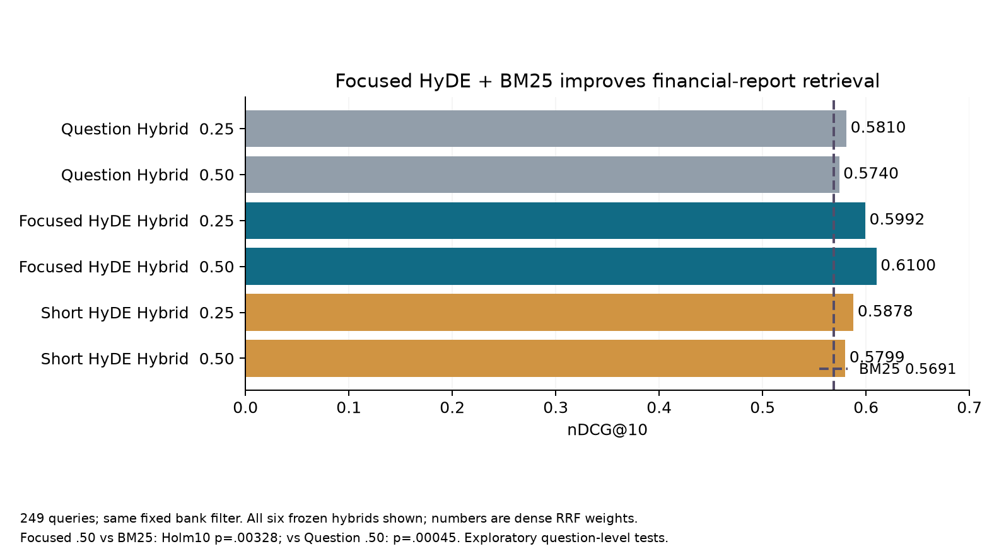
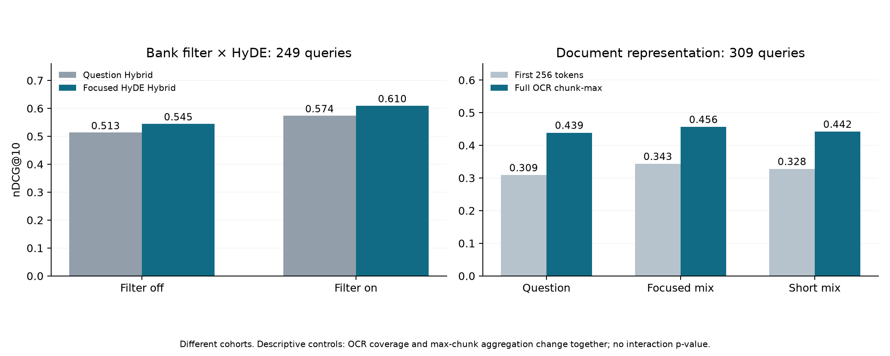
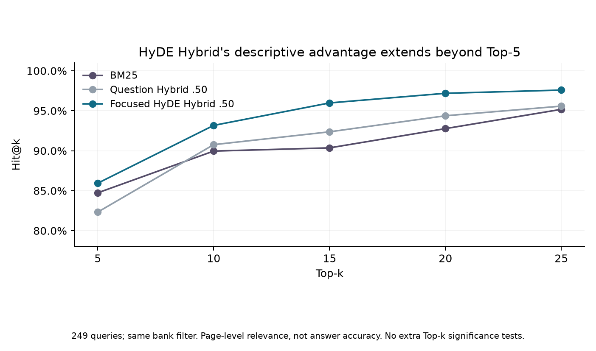

# HyDE for financial-report retrieval

Meeting 9 · 9 November 2026 · Cheryl

**Main finding:** Focused HyDE mixed with the original question improves retrieval when fused with BM25. On 249 queries, nDCG@10 is **0.6100**, versus **0.5691** for BM25 and **0.5740** for Question Hybrid at the same fusion weight.

These are exploratory results on a repeatedly inspected benchmark. Question-level tests do not adjust dependence from six shared annual reports. Final-answer accuracy remains unvalidated.

## 1. HyDE adds value beyond BM25 and ordinary fusion

viDoRe v3 Finance English: 2,942 pages and 309 queries. The table uses the remaining 249 queries after an initial 60-query development stage. All methods use the same fixed question-only bank filter. Each Hybrid fuses dense and BM25 Top 100 ranks with RRF constant 60.

| Query / method | Dense RRF weight | nDCG@10 | Holm10 p vs BM25 | Holm10 p vs same-weight Question Hybrid |
|---|---:|---:|---:|---:|
| BM25 | — | 0.5691 | — | — |
| Question Hybrid | 0.25 | 0.5810 | 1.00000 | — |
| Question Hybrid | 0.50 | 0.5740 | 1.00000 | — |
| Focused HyDE Hybrid | 0.25 | 0.5992 | 0.00030 | 0.03241 |
| **Focused HyDE Hybrid** | **0.50** | **0.6100** | **0.00328** | **0.00045** |
| Short HyDE Hybrid | 0.25 | 0.5878 | 0.20406 | 1.00000 |
| Short HyDE Hybrid | 0.50 | 0.5799 | 1.00000 | 1.00000 |



The 10-test family uses 100,000 two-sided paired sign flips and Holm correction. It covers six comparisons against BM25 and four HyDE comparisons against matching Question Hybrids. It does not correct earlier adaptive experiments. [All 10 tests](data/primary_tests.csv) · [249 paired differences](data/paired_ndcg_differences.csv).

## 2. The gain is not limited to bank filtering

Same 249 queries, fixed dense RRF weight 0.50:

| Bank filter | Question Hybrid | Focused HyDE Hybrid | HyDE increment |
|---|---:|---:|---:|
| Off | 0.5134 | 0.5450 | +0.0316 |
| On | 0.5740 | 0.6100 | +0.0360 |

Both conditions show a descriptive HyDE gain. The filter × HyDE interaction is +0.0044; no interaction test was added. Leaving out each annual report keeps the Focused 0.50 gain over BM25 positive (+0.0282 to +0.0490). These are descriptive stress tests, not independent source-level inference.

Full-page OCR representation also matters. Across 309 queries, Question dense rises from 0.3085 to 0.4385 and Focused mix from 0.3432 to 0.4563 when first-256-token page vectors are replaced with full-OCR chunk-max retrieval. Coverage and score aggregation change together.



## 3. Prompt transfer and deeper retrieval

- Transferring frozen Focused and Short prompts improves the first-256-token Question dense baseline on 249 queries: ΔnDCG@10 = +0.0378 / +0.0178, with Holm4 p = 0.00936 / 0.04158 in a separate test family. Short does not establish an advantage over Focused.
- The length × constraint-wording experiment, using 20 Legal and 20 FiQA queries, has **no significant comparison after Holm12**. It does not establish why the earlier FiQA Short prompt worked.
- Focused Hybrid's descriptive advantage continues beyond Top 5:

| Same bank filter;249 queries | Hit@5 | Hit@10 | Hit@15 | Hit@20 | Hit@25 |
|---|---:|---:|---:|---:|---:|
| BM25 | 84.7% | 90.0% | 90.4% | 92.8% | 95.2% |
| Question Hybrid .50 | 82.3% | 90.8% | 92.4% | 94.4% | 95.6% |
| Focused HyDE Hybrid .50 | 85.9% | 93.2% | 96.0% | 97.2% | 97.6% |



No extra significance tests were added for each Top-k. Page-level Hit is not evidence completeness or answer accuracy.

## 4. Cost and local search efficiency

| Same bank filter;249 queries | Fresh HyDE USD/query | Cached-vector retrieval p50 | Modeled fresh retrieval p50 |
|---|---:|---:|---:|
| BM25 | 0 | 1.116ms | 0.0011s |
| Question Hybrid .50 | 0 | 1.450ms | 0.0035s |
| Focused HyDE Hybrid .50 | 0.001924 | 1.458ms | 3.0855s |

Modeled totals add historical generation durations to separately profiled warm local encoding/retrieval. They are not measured end-to-end latency. The separate 20-query sample costs about $0.007958/query for fresh Focused HyDE plus reader, excluding evaluation judges.

On 628 existing FiQA queries, HNSW M32/efSearch64 reduces warm Short-mix vector search p50 from 1.154 ms to 0.095 ms, retaining 99.32% of exact Top 10 neighbors. nDCG@10 changes from 0.385824 to 0.383559; serialized index size rises from 88.53 to 104.22 MB. This measures index search, not total RAG speed. [All seven settings](data/hnsw.csv) · [Chart](figures/hnsw.png).

## Scope and reproducibility

The reader study saved 80 answers from 66 unique calls. Both automated raters failed predefined checks by confusing an evidence-based abstention with a complete numeric answer. Their scores are excluded from accuracy claims; human review remains pending. [Acceptance failure](data/reader_acceptance.json).

The original query 39 contains an appended answer hint. It lies in the initial 60, is excluded from the reader sample, and does not affect the remaining 249. This is not an exhaustive leakage audit. The bank filter removes some positive labels for 13/249 queries; all original metric denominators are retained.

Generator/reader: `gpt-5.4-2026-03-05`, temperature 0, reasoning none, no tools. Encoder: pinned `all-MiniLM-L6-v2`, mean pooling, L2 normalization. HyDE query mixing is 50/50 before retrieval; this differs from the RRF fusion weight.

Rebuild the 10-test results and four charts from included data, with no API or model download:

```bash
cd presentation/meeting9_findings_20261109
python -m pip install -r requirements.txt
OPENBLAS_NUM_THREADS=1 python reproduce.py
```

[All 13 research questions](EXPERIMENTS.md) · [Source code and full-run requirements](REPRODUCIBILITY.md) · [Frozen protocols and independent checks](data/protocols_and_checks.json) · [All Top-k metrics](data/hybrid_all_k.csv).
