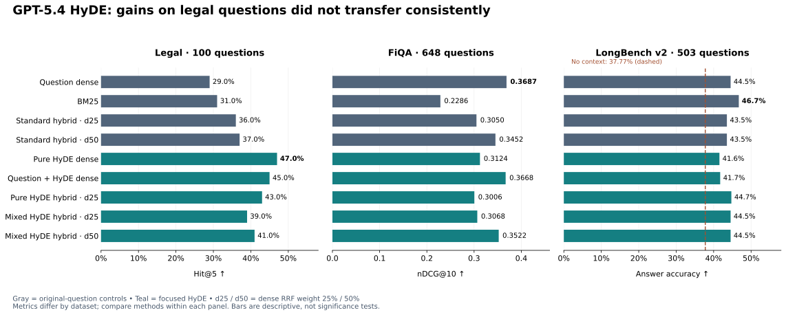

# FiQA + LongBench v2: HyDE transfer

**The legal improvement did not repeat. FiQA favors question dense; LongBench favors BM25 descriptively.**

| Method | FiQA nDCG@10 ↑ | LongBench accuracy ↑ |
|---|---:|---:|
| Question dense | **0.3687** | 44.53% |
| BM25 | 0.2286 | **46.72%** |
| Standard hybrid d25 | 0.3050 | 43.54% |
| Standard hybrid d50 | 0.3452 | 43.54% |
| Pure HyDE dense | 0.3124 | 41.55% |
| Question + HyDE dense | 0.3668 | 41.75% |
| Pure HyDE hybrid d25 | 0.3006 | 44.73% |
| Mixed HyDE hybrid d25 | 0.3068 | 44.53% |
| Mixed HyDE hybrid d50 | 0.3522 | 44.53% |
| Reader without context | — | 37.77% |

Bold = best observed per column, not significance. d25/d50 are dense fusion weights; all HyDE methods use focused160.

| Evidence | Conclusion |
|---|---|
| FiQA pure vs question dense | Significant decline, Holm p ≈ 0.00012 |
| FiQA mixed dense vs question dense | No significant change, Holm p = 1 |
| FiQA mixed hybrid d50 vs standard d50 | No significant gain, Holm p ≈ 0.9246 |
| Mixed hybrid d50 vs standard d25 | FiQA gain is significant, but changes both query and weight |
| LongBench planned comparisons | None significant after Holm correction |

## Scope & audit

| | FiQA | LongBench v2 |
|---|---|---|
| Evaluation | All 648 test queries; 57,638 documents | All 503 questions, six domains, three length groups |
| Primary metric | nDCG@10; unjudged docs count as nonrelevant | Multiple-choice answer accuracy; no chunk-relevance labels |
| Input | Dense: first 256 document tokens; BM25: full document | Own complete context searched; 224-token chunks / 32 overlap |
| Reader | None | Same GPT-5.4 reader; top 5 real chunks |
| Completion | ✓ All queries | ✓ 5,030 logical predictions; 4,686 unique reader calls |
| Validation | ✓ Saved metrics | ✓ All predictions, prompts, spans and 2,515 RRF ranks; **219/1,509 dense ranks** replayed |

Dense audit is partial after cache loss; evaluation is complete. LongBench is a custom RAG adaptation, not an official leaderboard replication. Its question-level tests do not model shared-context correlation. FiQA does not apply BEIR's identical query/document ID filter.

## Files

[FiQA metrics](fiqa_metrics.csv) · [FiQA per-query scores](fiqa_per_query_metrics.csv) · [LongBench accuracy & subgroups](longbench2_accuracy.csv) · [Predictions](longbench2_predictions.csv) · [Paired tests](paired_tests.csv) · [Protocol](protocol.json) · [Completion status](completion_status.json) · [Technical details](technical_details.md) · [Raw results ZIP](raw_results.zip) · [Run code](../../../person3_cross_dataset/README.md) · [Main findings](../../../main_findings.md)

Raw ZIP retains prompts, outputs, checkpoints, rankings and the original detailed reports. Cost: $17.84334 estimated from saved API usage; $20.940845 including unresolved-attempt reserve and recovery allowance. These are estimates, not billing statements.
