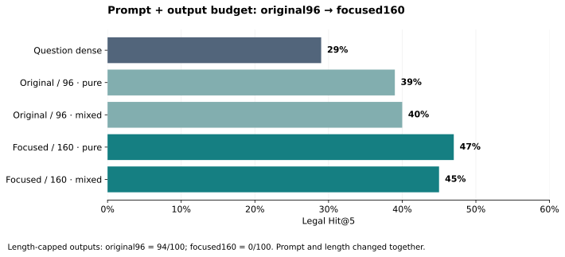

# Legal: GPT-5.4 HyDE

**Best observed Hit@5: 47% pure HyDE; mixed HyDE reaches 45%, vs 29% question dense.**

| Focused160 method | Hit@5 | Same-route control | Change |
|---|---:|---:|---:|
| Pure dense | 47% | Question dense 29% | +18 pp |
| Question + HyDE dense | 45% | Question dense 29% | +16 pp |
| Pure hybrid d25 | 43% | Standard hybrid d25 36% | +7 pp |
| Mixed hybrid d25 | 39% | Standard hybrid d25 36% | +3 pp |
| Mixed hybrid d50 | 41% | Standard hybrid d50 37% | +4 pp |

| Check | Result |
|---|---|
| Scope | 100 previously inspected questions; 4,876 passages |
| Mixed dense vs question dense | Holm p = 0.0185 |
| Pure dense vs question dense | Holm p = 0.0707; not significant after correction |
| Prompt change | Original96 → focused160 changes wording **and** length |
| Previous local model | Qwen3-1.7B original96 pure: 28%; GPT-5.4 original96 pure: 39% |
| Historical SmolLM3 | Pure 29%, mixed 37%, hybrid 40%; aggregates only, no retained paired outputs |
| Validation | ✓ Independent replay; 200 generations / 14 retrieval methods |

No final-answer evaluation. Legal results are development evidence, not held-out generalization; prior local-model comparisons also differ in tokenization and decoding.

[All metrics](comparison_k5.csv) · [Paired tests](paired_tests.csv) · [Protocol](protocol.json) · [Technical details](technical_details.md) · [Raw results ZIP](raw_results.zip) · [Run code](../../person3_openai_hyde/README.md) · [Three-dataset overview](../../main_findings.md)

The ZIP preserves original outputs, rankings, embeddings and validation files. Its archived findings are the original detailed report; this page is the concise reading entry.
