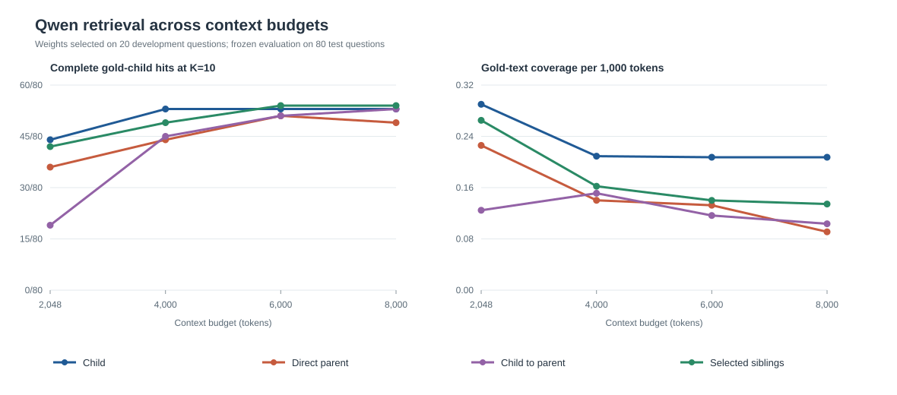

# Qwen hybrid tuning and context-budget curve

Qwen document window: 4,096 tokens (frozen Week 6 development choice). Budgets below use the pinned, untruncated MiniLM measurement tokenizer. The Qwen and BM25 top-100 rankings were reused or reconstructed; no embeddings were rerun.

Selection used only 20 development questions. For each budget and hierarchy mode, the BM25 weight among 0, .25, .5, .75, and 1 was chosen by Hit@10, then gold-text coverage, coverage per token, fewer returned tokens, and lower BM25 weight. The four selected mode configurations were then evaluated once on 80 test questions.

## Development-selected strategy by budget

| Budget | Mode | BM25 weight | Dev Hit@10 | Test Hit@5 | Test Hit@10 | Test coverage | Mean tokens | Test coverage / 1k |
|---:|---|---:|---:|---:|---:|---:|---:|---:|
| 2,048 | child | 0.00 | 11/20 | 42/80 | 44/80 | 59.3% | 2037 | 0.290 |
| 4,000 | child | 0.00 | 12/20 | 44/80 | 53/80 | 66.2% | 3170 | 0.209 |
| 6,000 | child_to_selected_siblings | 0.00 | 13/20 | 48/80 | 54/80 | 67.5% | 4882 | 0.140 |
| 8,000 | child_to_selected_siblings | 0.00 | 13/20 | 48/80 | 54/80 | 67.5% | 5205 | 0.134 |

## All frozen mode configurations on test

| Budget | Mode | BM25 weight | Hit@5 | Hit@10 | Coverage | Mean tokens | Coverage / 1k |
|---:|---|---:|---:|---:|---:|---:|---:|
| 2,048 | child | 0.00 | 42/80 | 44/80 | 59.3% | 2037 | 0.290 |
| 2,048 | parent | 0.00 | 36/80 | 36/80 | 46.3% | 2048 | 0.226 |
| 2,048 | child_to_parent | 0.75 | 19/80 | 19/80 | 25.5% | 2044 | 0.125 |
| 2,048 | child_to_selected_siblings | 0.00 | 42/80 | 42/80 | 52.5% | 1986 | 0.265 |
| 4,000 | child | 0.00 | 44/80 | 53/80 | 66.2% | 3170 | 0.209 |
| 4,000 | parent | 0.50 | 42/80 | 44/80 | 55.0% | 3941 | 0.140 |
| 4,000 | child_to_parent | 0.00 | 44/80 | 45/80 | 59.6% | 3928 | 0.151 |
| 4,000 | child_to_selected_siblings | 0.00 | 47/80 | 49/80 | 61.3% | 3751 | 0.162 |
| 6,000 | child | 0.00 | 44/80 | 53/80 | 66.2% | 3203 | 0.207 |
| 6,000 | parent | 0.00 | 45/80 | 51/80 | 63.7% | 5140 | 0.132 |
| 6,000 | child_to_parent | 0.00 | 49/80 | 51/80 | 63.7% | 5482 | 0.116 |
| 6,000 | child_to_selected_siblings | 0.00 | 48/80 | 54/80 | 67.5% | 4882 | 0.140 |
| 8,000 | child | 0.00 | 44/80 | 53/80 | 66.2% | 3203 | 0.207 |
| 8,000 | parent | 0.50 | 44/80 | 49/80 | 61.3% | 7174 | 0.091 |
| 8,000 | child_to_parent | 0.00 | 51/80 | 53/80 | 66.4% | 6629 | 0.104 |
| 8,000 | child_to_selected_siblings | 0.00 | 48/80 | 54/80 | 67.5% | 5205 | 0.134 |

## Qwen dense-only comparator

| Budget | Mode | Hit@5 | Hit@10 | Coverage | Mean tokens | Coverage / 1k |
|---:|---|---:|---:|---:|---:|---:|
| 2,048 | child | 42/80 | 44/80 | 59.3% | 2037 | 0.290 |
| 2,048 | parent | 36/80 | 36/80 | 46.3% | 2048 | 0.226 |
| 2,048 | child_to_parent | 33/80 | 33/80 | 43.4% | 2048 | 0.212 |
| 2,048 | child_to_selected_siblings | 42/80 | 42/80 | 52.5% | 1986 | 0.265 |
| 4,000 | child | 44/80 | 53/80 | 66.2% | 3170 | 0.209 |
| 4,000 | parent | 45/80 | 48/80 | 60.2% | 3854 | 0.161 |
| 4,000 | child_to_parent | 44/80 | 45/80 | 59.6% | 3928 | 0.151 |
| 4,000 | child_to_selected_siblings | 47/80 | 49/80 | 61.3% | 3751 | 0.162 |
| 6,000 | child | 44/80 | 53/80 | 66.2% | 3203 | 0.207 |
| 6,000 | parent | 45/80 | 51/80 | 63.7% | 5140 | 0.132 |
| 6,000 | child_to_parent | 49/80 | 51/80 | 63.7% | 5482 | 0.116 |
| 6,000 | child_to_selected_siblings | 48/80 | 54/80 | 67.5% | 4882 | 0.140 |
| 8,000 | child | 44/80 | 53/80 | 66.2% | 3203 | 0.207 |
| 8,000 | parent | 46/80 | 54/80 | 67.5% | 5770 | 0.128 |
| 8,000 | child_to_parent | 51/80 | 53/80 | 66.4% | 6629 | 0.104 |
| 8,000 | child_to_selected_siblings | 48/80 | 54/80 | 67.5% | 5205 | 0.134 |

The hybrid weights selected for direct parents at 4,000 and 8,000 tokens score 44/80 and 49/80 on test, versus 48/80 and 54/80 for Qwen dense alone. The 0.75 BM25 weight selected for child-to-parent at 2,048 tokens scores 19/80, versus 33/80 for dense. These reversals show how unstable tuning can be with only 20 development questions; the frozen results do not support a held-out hybrid advantage.

## Direct-parent wins over child-to-parent expansion

This diagnostic compares both modes at the development-selected **direct-parent weight** for each budget. It uses test questions only after the weight was frozen. The full per-question parent lists, ranks, gold-child token positions, and cutoff causes are in `parent_wins.csv`.

- 2,048: 9 direct-parent-only hits; 1 with gold parents absent from expanded top-10 seeds, 8 present but beyond the context cutoff.
- 4,000: 13 direct-parent-only hits; 5 with gold parents absent from expanded top-10 seeds, 8 present but beyond the context cutoff.
- 6,000: 6 direct-parent-only hits; 4 with gold parents absent from expanded top-10 seeds, 2 present but beyond the context cutoff.
- 8,000: 6 direct-parent-only hits; 5 with gold parents absent from expanded top-10 seeds, 1 present but beyond the context cutoff.

For example, at 4,000 tokens, question 20 puts gold child `4.6-c4-s1` at tokens 1–397 in the directly retrieved parent. The expanded ranking places the same child at tokens 5,948–6,344, past the cutoff. Question 6 shows a ranking failure: direct parent `1.7-c3` ranks first, but none of the ten child seeds belongs to it. These examples are diagnostic observations, not additional tuning.

Coverage per 1k is the mean of per-question coverage fractions divided by returned tokens, multiplied by 1,000. Hit@k requires a complete gold child in delivered context; coverage includes partial gold text. The 20-question development set and 80-question test set are small and drawn from one legal corpus. Differences among close methods are descriptive.
